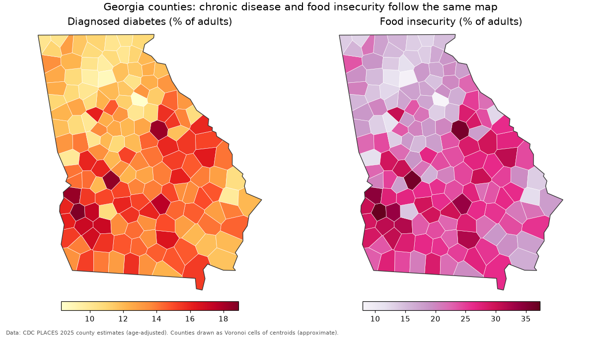
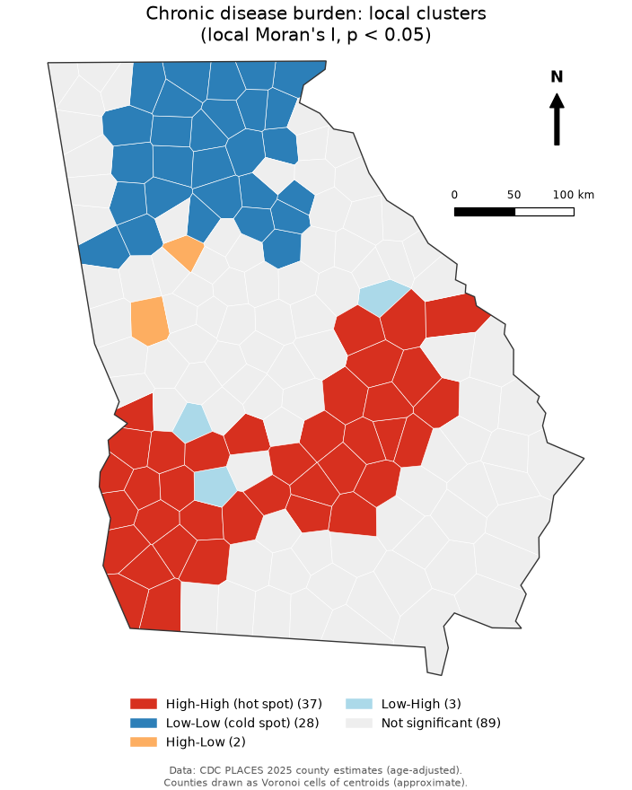
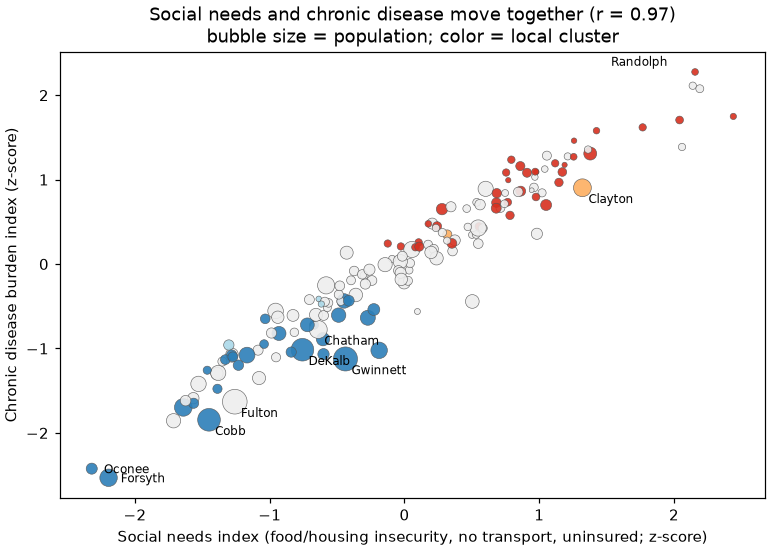

# Georgia County Health Atlas

**Where are chronic disease and unmet social needs concentrated in Georgia, and do they cluster in space?** This project uses the CDC's 2025 PLACES estimates for all 159 Georgia counties. It loads them into a SQL database, builds composite indices, and finds statistically significant hot spots with global and local Moran's I.

[](https://github.com/rajibhossain26/georgia-health-atlas/actions/workflows/tests.yml)
[](https://github.com/rajibhossain26/georgia-health-atlas/actions/workflows/results.yml)




## Key findings

1. **Chronic disease is strongly clustered in space.** Global Moran's I for a combined chronic-disease burden index (diabetes, obesity, coronary heart disease, stroke, high blood pressure) is **0.54** (p < 0.001, 9,999 permutations). Diagnosed diabetes alone gives I = 0.51.
2. **There are two hot-spot belts in rural South and East-Central Georgia.** Local Moran's I identifies **37 hot-spot counties**, with high burden surrounded by high burden, home to about **597,000 people**. They form a southwest belt (Randolph, Stewart, Terrell, Calhoun, Baker, Dougherty and neighbors) and a belt running from east-central down to south-central Georgia (Jefferson, Washington, Johnson, Emanuel, Treutlen, Telfair and neighbors). In these counties, **15.3%** of adults have diagnosed diabetes and **27.6%** report food insecurity, compared with 11.2% and 15.5% in the cold spots.
3. **The cold spot is metro-north Georgia.** 28 counties from Cobb, Cherokee, Forsyth and Gwinnett to the north Georgia mountains form a low-burden cluster. They hold **4.7 million people (42% of the state)**.
4. **Clayton County is a high outlier.** Clayton (298,000 residents) has a high burden next to lower-burden metro neighbors, a "High-Low" outlier. It is easy to miss in a metro-wide average.
5. **Social needs and chronic disease go together.** Across counties, an index of food insecurity, housing insecurity, lack of transportation and no health insurance correlates at r = 0.97 with chronic-disease burden. 29 counties are in the top fifth for *both* diabetes and food insecurity.
6. **Small counties carry a heavier burden.** In the 118 counties under 50,000 residents, adult diabetes is 13.0% and uninsurance 15.2%. In larger counties the figures are 11.9% and 13.0% (population-weighted).

| Hot spots and cold spots | Social needs vs chronic disease |
| --- | --- |
|  |  |

Full tables are in [`results/RESULTS.md`](results/RESULTS.md), and county-level indices and cluster labels are in [`results/county_indices.csv`](results/county_indices.csv).

## Methods

| Step | Detail |
| --- | --- |
| Data | [CDC PLACES: County Data (GIS Friendly Format), 2025 release](https://data.cdc.gov/d/i46a-9kgh): age-adjusted prevalence for adults, with county centroids. The Georgia outline is from Census TIGERweb (generalized). |
| Database | [`sql/schema.sql`](sql/schema.sql) builds a SQLite database. [`sql/queries.sql`](sql/queries.sql) has population-weighted averages, rankings, `NTILE` window functions and a join with the analysis results. |
| Indices | Chronic burden is the mean z-score of diabetes, obesity, CHD, stroke and high blood pressure. Social needs is the mean z-score of food insecurity, housing insecurity, lack of reliable transportation and no health insurance (18–64). |
| Spatial weights | Delaunay triangulation of county centroids, with edges over 100 km removed, row-standardized |
| Statistics | Global Moran's I and local Moran's I (Anselin 1995) with conditional permutation inference (9,999 permutations), implemented from scratch in [`src/atlas/spatial.py`](src/atlas/spatial.py) and unit-tested on synthetic patterns |
| Maps | Counties are drawn as Voronoi cells of their centroids, clipped to the state outline. This is an *approximation* of real boundaries that keeps the repository small. |

## Important caveats

- **PLACES values are model-based small-area estimates, not direct measurements.** CDC estimates them from BRFSS survey data combined with Census demographics, so measures that share demographic predictors are strongly correlated by construction. The r = 0.97 above is a description of where burdens overlap, **not evidence that one causes another**.
- County averages hide variation within counties (the ecological fallacy). The same analysis with PLACES census-tract data is a natural next step.
- p-values from local Moran's I are not corrected for multiple comparisons. Treat the hot spots as screening results.

## Reproduce

```bash
git clone https://github.com/rajibhossain26/georgia-health-atlas.git
cd georgia-health-atlas
pip install -r requirements.txt
python scripts/run_analysis.py      # builds results/atlas.sqlite, results/RESULTS.md and docs/*.png
pytest -q                           # 8 tests
sqlite3 results/atlas.sqlite < sql/queries.sql   # run the SQL directly
```

A GitHub Actions workflow re-runs the full analysis on every change and commits the figures and tables. Everything shown here is regenerated from code.

## Author

**Rajib Hossain**, PhD researcher in GIScience & environmental health, University of Georgia · [Website](https://rajibhossain26.github.io) · [LinkedIn](https://www.linkedin.com/in/hossainrajib)

## References

- Centers for Disease Control and Prevention. PLACES: Local Data for Better Health, 2025 release.
- Anselin, L. (1995). Local indicators of spatial association—LISA. *Geographical Analysis*, 27(2), 93–115.

MIT License
